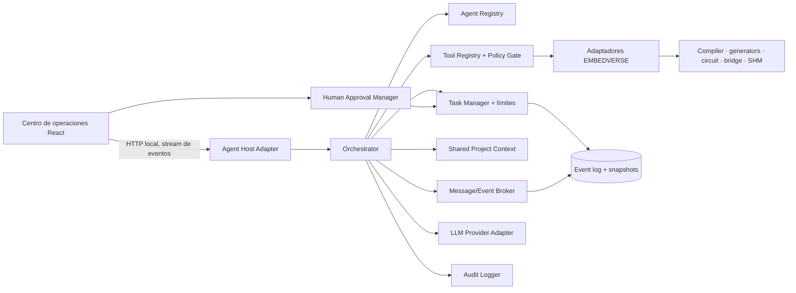

# EMBEVERSE AI Engineering Team — diseño técnico

**Estado:** Fases 1–3 implementadas parcialmente. Este documento combina la arquitectura objetivo con el inventario de lo que ya corre en el PC; las secciones 1–12 siguen describiendo alcance objetivo salvo donde la sección 13 confirma implementación.

## 1. Decisiones de arquitectura

1. Conservar la SPA React/TypeScript/Vite, los dominios existentes, IndexedDB, la API SHM y las herramientas locales. El equipo se integra como módulo nuevo, sin reemplazar los editores ni generadores.
2. Escribir contratos, orquestación y adaptadores en TypeScript, siguiendo el stack principal y evitando incorporar dependencias de cola o base de datos antes de necesitarlas.
3. Mantener proveedor de modelos detrás de una interfaz. El proveedor se selecciona mediante configuración del runtime; los secretos nunca pasan al navegador, al proyecto ni al registro de actividad.
4. Las llamadas de agentes, tareas y resultados son datos tipados y versionados. Toda transición emite un evento auditable.
5. Las herramientas son capacidades nombradas y acotadas. El modelo propone llamadas; un ejecutor local valida identidad, permisos, argumentos, recursos y nivel de aprobación antes de actuar.
6. El host de ejecución es un proceso local de Node que corre en este PC y puede permanecer activo independientemente de la interfaz. La API se liga solo a loopback. Vite sirve la interfaz y actúa como cliente; no es el host de agentes. El proceso local no es un servicio remoto ni se publica en red. La interfaz del host permitirá añadir un empaquetado de escritorio después de decidir Electron/Tauri.
7. Los proyectos fuente permanecen en el almacenamiento que ya tienen. El navegador entrega al runtime solo un contexto serializado y los recursos que la operación necesita; los agentes no consultan IndexedDB directamente.
8. El historial multiagente se guardará fuera del repositorio, en el directorio local de datos de EMBEDVERSE. La interfaz consume vistas del historial; IndexedDB no será una segunda autoridad para estados de ejecución.

### Consecuencias

- El primer prototipo es monousuario y local, coherente con el estado actual de la aplicación. Los agentes se ejecutarán en este PC.
- La interfaz podrá cerrarse sin detener una tarea; el proceso local continuará registrando su resultado. En el primer corte el proceso se inicia manualmente; el arranque automático queda para el empaquetado del host.
- El enlace con la plataforma SHM será mediante adaptador opcional, con alcance del token ya configurado; el runtime no almacenará ni ampliará credenciales SHM.
- No se adopta Redis, PostgreSQL adicional ni FastAPI para la cola: no hay un despliegue multiusuario de agentes que justifique esos servicios en esta etapa.

## 2. Componentes

### Responsabilidad y ubicación prevista

| Componente | Responsabilidad | Ubicación prevista |
|---|---|---|
| Agent Registry | Identidades, especialidades, capacidades y políticas versionadas | `src/agent-team/registry.ts` |
| Orchestrator | Ejecutar tareas, elegir agente/capacidad, resolver delegaciones y aplicar límites | `src/agent-team/orchestrator.ts` |
| Task Manager | Máquina de estados, vencimientos, cancelación, reintentos y presupuestos | `src/agent-team/tasks/` |
| Message Broker | Encolar solicitudes/respuestas y publicar eventos tipados | `src/agent-team/messaging/` |
| Shared Project Context | Proyecciones de proyecto con referencias a archivos, circuito, escena y resultados | `src/agent-team/context/` |
| Tool Registry | Esquemas, permisos, niveles de riesgo y ejecutores por herramienta | `src/agent-team/tools/` |
| Execution Manager | Ejecutar herramienta aprobada con timeout, límites y captura de evidencia | `server/agentTeam/` |
| Validation Engine | Reglas de formato, integridad y verificación posterior; no certificación profesional | `src/agent-team/validation/` |
| Audit Logger | Eventos inmutables con agente, operación, evidencia y resultado | `server/agentTeam/` |
| Human Approval Manager | Registrar solicitudes/aprobaciones vinculadas a la operación exacta | `server/agentTeam/approval.ts` |
| Provider Adapter | Interfaz con proveedor configurable; secretos leídos solo por el runtime | `server/agentTeam/providers/` |
| Operations UI | Estados, actividad, colaboración, diagnóstico y acciones humanas reales | `src/agent-team/ui/` |

La implementación inicial está repartida entre `src/agent-team/` (contratos, registro, políticas y estados) y `server/agentTeam/` (persistencia, API local, proveedor, herramientas y orquestador). La delegación, la aprobación de cambios delimitados y la UI de operaciones ya tienen una implementación inicial; la memoria de conocimiento avanzada sigue siendo objetivo.

## 3. Contratos principales

Los contratos persistidos llevan versión de esquema, fecha ISO UTC e identificador UUID. Las tareas actuales usan `schemaVersion: 2` e incluyen `requiresEvidence`; el runtime migra tareas de versión 1 al cargarlas. Versiones desconocidas se rechazan en vez de reinterpretarse silenciosamente.

### Agente

`AgentDefinition`: `id`, `name`, `specialty`, `description`, `capabilities[]`, `toolPolicy`, `providerProfile`, `maxTurns`, `maxToolCalls`, `maxDurationMs`, `maxTokens` (cuando aplique), `enabled`.

Identidades iniciales:

- `structural_engineer`: solicita o genera cambios conceptuales en geometría estructural; los resultados siempre declaran supuestos y límites profesionales.
- `software_engineer`: diagnostica el código y puede invocar herramientas aprobadas de inspección, cambios delimitados, compilación y pruebas existentes.
- `mechatronics_engineer`: trabaja con el DTO `ElectronicCircuit`, placas, bibliotecas y firmware; distingue compilación/simulación de comprobación física.

Las definiciones no otorgan permisos implícitos del sistema operativo. El registro de herramientas es la fuente de autorización.

### Tarea

`AgentTask`: `id`, `projectId`, `goal`, `requestedBy`, `assignedAgentId`, `state`, `priority`, `contextRefs[]`, `expectedResult`, `createdAt`, `updatedAt`, `deadlineAt`, `budget`, `attempt`, `parentTaskId?`, `cycleKey?`, `approvalIds[]`, `result?`, `error?`.

Estados canónicos: `PENDING`, `IN_PROGRESS`, `WAITING_FOR_AGENT`, `WAITING_FOR_HUMAN`, `COMPLETED`, `FAILED`, `CANCELLED`. Las transiciones se validan en una sola máquina de estados; la UI no las cambia directamente.

### Mensaje y evento

`AgentMessage`: `id`, `projectId`, `taskId`, `senderAgentId`, `recipientAgentId`, `requestType`, `description`, `technicalContext`, `resourceRefs[]`, `priority`, `state`, `expectedResult`, `createdAt`, `correlationId`, `causationId?`.

`AgentEvent`: `id`, `sequence`, `projectId`, `taskId`, `type`, `actor`, `timestamp`, `payload`, `evidenceRefs[]`, `correlationId`. Eventos incluyen `task.created`, `task.state_changed`, `agent.message_sent`, `tool.requested`, `approval.requested`, `approval.decided`, `tool.started`, `tool.completed`, `tool.failed` y `task.completed`.

Las respuestas y descubrimientos son mensajes/eventos nuevos; no sobreescriben el mensaje original. El campo `state` en la solicitud es una vista actualizada por el gestor, con cada transición preservada en el registro.

### Memoria

Cada `KnowledgeRecord` contiene `id`, `projectId?`, `category`, `subject`, `content`, `sourceRefs[]`, `createdBy`, `createdAt`, `version`, `verificationLevel`, `verifiedBy?`, `supersedes?`. Categorías: proyecto, técnica, componente, error, solución e historial de decisiones/tareas.

La memoria es append-only para conocimiento verificado: una corrección crea una versión nueva y apunta a la anterior. Los datos derivados de una IA quedan etiquetados como no verificados hasta su validación.

## 4. Persistencia y recuperación

El runtime local será la autoridad para tareas y eventos. Implementación inicial: almacenamiento append-only versionado bajo `EMBEDVERSE_DATA_DIR` (por omisión, `%LOCALAPPDATA%\\EMBEDVERSE\\agent-runtime` en Windows y directorio de estado local del usuario en otros sistemas), una línea JSON por evento y huella SHA-256 encadenada. Un archivo de bloqueo permite un solo proceso escritor; cada append se vacía a disco antes de confirmar la operación. No se guardan prompts completos, claves ni payloads binarios por defecto; se guardan referencias, huellas y evidencia textual acotada.

Antes de implementar se confirmarán compatibilidad de escritura atómica y bloqueo de procesos en Windows. Si la serialización de un solo proceso no puede garantizar consistencia o recuperación, se elegirá una base local transaccional detrás de la misma interfaz de repositorio; la UI y los agentes no dependerán del formato físico.

Al arrancar, el runtime valida versiones e integridad, reconstruye el estado desde eventos y marca como fallida cualquier ejecución interrumpida, conservando su evidencia. Nunca reanuda automáticamente una herramienta con efectos laterales. Una recuperación de archivo corrupto conserva el original y solicita intervención; no reemplaza datos sin aprobación.

## 5. Mensajería, orquestación y límites

- Broker en proceso con cola persistente, consumidores explícitos y eventos ordenados por secuencia.
- Una tarea tiene un agente responsable. Delegar crea una subtarea y un mensaje con `parentTaskId`; el resultado vuelve al responsable mediante un evento correlacionado.
- El equipo no abre conversaciones libres: cada turno debe resolver el objetivo de tarea o una solicitud definida. Un grafo de delegación no puede volver a un agente/objetivo ya presente en la cadena.
- Valores iniciales de política, ajustables por configuración: máximo 12 turnos por tarea, 20 invocaciones de herramientas, 3 reintentos idempotentes y 10 minutos de ejecución total. La política del proyecto puede reducirlos; no ampliarlos desde el modelo.
- Cada llamada de proveedor y herramienta consume el presupuesto. Timeout o presupuesto agotado produce `WAITING_FOR_HUMAN` si hace falta una decisión; de otro modo `FAILED` con causa y evidencia.
- La cancelación previene nuevos pasos y envía terminación cooperativa al proceso activo; el runtime marca si el proceso no pudo detenerse.
- Repetir una operación debe usar clave idempotente cuando el adaptador lo soporte. No reintentar automáticamente cambios de archivo, descargas ni despliegues.

## 6. Herramientas y permisos

Cada herramienta define `id`, `inputSchema`, `outputSchema`, `allowedAgents`, `risk`, `timeoutMs`, límites de entrada/salida, si es idempotente y `approvalPolicy`.

| Nivel | Ejemplos iniciales | Regla |
|---|---|---|
| Lectura | Inspeccionar archivos del proyecto compartidos, leer catálogo/placas, consultar estado de compilador, leer resultados SHM de rutas permitidas | Automático; rutas y tamaño acotados; registrar acceso/resultado |
| Ejecución controlada | Compilar sketch, validar circuito, llamar generador conceptual, correr suite existente explícitamente seleccionada | Solo sandbox/local; timeout y directorio temporal; el usuario inicia o la política permite |
| Escritura reversible | Crear parche propuesto o actualizar archivo de trabajo aislado | Requiere mostrar diff y aprobación humana antes de aplicar |
| Sensible/prohibido | Borrar datos, reemplazar base, instalar dependencias globales, cambiar secretos, hacer push/deploy, flashear placa o enviar operación física | No disponible en la primera versión; futura herramienta separada con aprobación específica o bloqueo permanente |

El software engineer no recibe shell irrestricto. Su primera interfaz de cambio produce un diff, calcula rutas tocadas y huella antes/después. La aplicación del parche verifica que las entradas no hayan cambiado desde la aprobación. Las herramientas de compilación/simulación reutilizan adaptadores existentes cuando sea posible, tras confirmar sus reglas de origen y disponibilidad en el host.

## 7. Proveedor de modelos y secretos

`ModelProvider` expone `complete(request, signal)` y reporta proveedor/modelo, uso, duración y error normalizado. Los perfiles declaran capacidades, límites y política de privacidad. La clave se lee en el runtime desde variables de entorno o configuración local protegida; nunca desde `VITE_*`, almacenamiento del navegador, logs, memoria ni archivos versionados. `.env.example` contendrá solo nombres y valores vacíos.

Si no hay credencial o proveedor configurado, la tarea queda en `WAITING_FOR_HUMAN` con instrucciones de configuración; no se sustituye por una respuesta fija que aparente ser un agente.

## 8. Integración con datos reales de EMBEVERSE

- Firmware: referencia a `EmbeddedProject.files`; la UI entrega solo los archivos seleccionados y vigentes para la tarea.
- Electrónica: `ElectronicCircuit` y biblioteca declarativa existente; validaciones existentes conservan su alcance estructural, no eléctrico.
- Estructuras: `BridgeSceneDocument`, generador conceptual de puentes/edificios y contratos de `structural-ai`; geometría no se presenta como cálculo ni aprobación.
- Compilación/simulación: adaptadores a endpoints existentes con resultados y logs originales; el agente no infiere éxito si no recibe código de salida exitoso y evidencia.
- SHM: adaptador de consulta a la API autorizada de solo lectura. No mezcla historiales, tokens ni credenciales entre proyectos.
- Importación de nuevas bibliotecas: primera versión investiga y propone paquete con fuente, versión, licencia y resumen de compatibilidad; no descarga ni instala automáticamente.

## 9. Centro de operaciones

La UI se divide en Operaciones, Comunicaciones, Proyectos, Diagnóstico y Actividad. Cada vista se alimenta de consultas al runtime; estado y logs no se inventan desde componentes React. Las acciones disponibles son iniciar tarea, aprobar/rechazar una operación concreta, pausar, reanudar o cancelar. Cada acción requiere resultado del runtime y se refleja mediante eventos. Las herramientas sin backend real se muestran como no disponibles, sin botones decorativos.

El stream de eventos inicia con polling/long-poll sobre el host local; WebSocket no es necesario para la primera entrega. El cliente reconcilia por `sequence` y solicita el tramo faltante tras reconexión.

## 10. Flujo de aceptación inicial: sensor de vibración en puente

1. La tarea queda enrutada a mecatrónica con referencias a proyecto, placa, circuito y puente.
2. El agente registra que el componente falta en el catálogo y crea solicitud estructurada al agente de software.
3. Software inspecciona catálogo y registro de bibliotecas; prepara informe de fabricante/fuente/licencia/compatibilidad, sin instalar automáticamente.
4. Si se autoriza incorporar la dependencia, la integración ocurre en entorno aislado y propone diff. Se compila con un adaptador real disponible; ausencia de simulador se declara.
5. Mecatrónica actualiza circuito/firmware como diff propuesto, valida circuito y compila; se registran artefactos y límites.
6. Estructural recibe posición/espacio/requisitos físicos, los asocia al componente de escena y solicita aclaración si falta geometría suficiente.
7. Los agentes comparten errores como tareas correlacionadas; tras cada cambio se ejecutan de nuevo solo las validaciones afectadas.
8. El informe reúne fuentes, componentes, arquitectura, diffs aprobados, resultados de compilación/simulación, errores, correcciones y limitaciones. Sin prueba física, revisión profesional o cálculo, el estado no puede ser “validado” en esos sentidos.

## 11. Incrementos de implementación

1. Contratos, máquina de estados, registro tipado, políticas y persistencia/event log; todavía sin modelo ni llamadas a procesos.
2. Runtime local con API de tareas/eventos/aprobaciones y herramienta de inspección de solo lectura.
3. Adaptador de proveedor con configuración segura y ejecución acotada de turnos.
4. Delegación estructurada de los tres agentes y memoria versionada.
5. Herramientas de compilación/validación existentes y aprobación de diffs.
6. Centro de operaciones conectado a datos reales.
7. Flujo de aceptación end-to-end, pruebas de fallos y documentación de instalación.

Cada incremento debe probarse antes de habilitar el siguiente. No se declara la misión completa hasta cubrir las doce pruebas obligatorias de la solicitud y dejar explícitas las capacidades todavía no disponibles.

## 12. Decisiones pendientes antes de ampliar el host

- Arranque del proceso local: manual en el primer corte; decidir instalador/arranque de usuario al seleccionar Electron/Tauri o servicio local.
- Proveedor/modelos concretos: se seleccionarán por privacidad, disponibilidad y coste al configurar el proveedor; el diseño no incluye una clave ni asume un modelo.
- Persistencia local: validar el esquema append-only en Windows con apagado/reinicio y dos procesos; migrar a SQLite si la recuperación o concurrencia lo exige.
- Sandbox de procesos: las protecciones actuales del compilador no son un sandbox del SO; cualquier ejecución de proyecto no confiable requiere aislamiento adicional.

## 13. Runtime y orquestador local (Fase 3, incrementos iniciales)

El runtime se compila y ejecuta en este PC con `npm run agent:runtime`. Para iniciar Ollama, runtime e interfaz desde una sola orden en Windows, usa `npm run agent:start`; el iniciador reutiliza servicios activos y comprueba que `qwen2.5-coder:7b` esté instalado. El panel queda en `http://127.0.0.1:5174/` y el runtime escucha únicamente en `127.0.0.1:5175`. Los procesos se ejecutan en segundo plano y sus logs están en `%LOCALAPPDATA%\EMBEDVERSE\logs`. `EMBEDVERSE_AGENT_PORT` y `EMBEDVERSE_DATA_DIR` permiten cambiar puerto y directorio del runtime. El proceso del runtime se cierra desde el administrador de tareas; al cerrar normalmente vacía el registro y libera el bloqueo.

El proveedor inicial es Ollama en `http://127.0.0.1:11434`, con `qwen2.5-coder:7b` como modelo por omisión en este PC. Se puede cambiar mediante `EMBEDVERSE_OLLAMA_URL` (solo loopback) y `EMBEDVERSE_OLLAMA_MODEL`. No se envían proyectos a servicios externos ni se incluye una clave de proveedor. Si Ollama no está escuchando o el modelo falta, la tarea pasa a `WAITING_FOR_HUMAN`; tras iniciar/cargar Ollama se reanuda por `POST /api/agent-team/tasks/{id}/resume`.

El orquestador ejecuta una tarea a la vez para limitar el consumo local. Los tres perfiles usan el mismo modelo local con instrucciones de especialidad distintas. La lista viva se obtiene de `GET /api/agent-team/agents`; `GET /api/agent-team/provider` informa el estado de Ollama. Al crear una tarea con `POST /api/agent-team/tasks`, se encola automáticamente si el proveedor está disponible. `POST /api/agent-team/tasks/{id}/transition` permite cancelarla; no permite que una persona marque su tarea como completada. Las tareas requieren evidencia por omisión. Antes de pedir el informe al modelo, el runtime realiza una inspección real y acotada del repositorio mediante lectura o búsqueda, registra la herramienta y entrega al modelo las referencias encontradas. Si no obtiene evidencia o falla el proveedor, la tarea no se marca completada y queda pendiente de supervisión.

Las herramientas de inspección activas son `workspace.read_file` y `workspace.search`, de solo lectura y restringidas al repositorio. Excluyen secretos, dependencias y datos locales, limitan tamaño y recorrido, rechazan rutas que atraviesen enlaces simbólicos, no ejecutan comandos y registran huellas/referencias sin guardar el contenido inspeccionado. Se añadió `team_delegate_task`: permite enviar una subtarea estructurada a otro especialista, suspende la tarea padre, ejecuta subtareas en la misma cola serial y devuelve el resultado como mensaje correlacionado para reanudar la tarea padre. Se limitan las subtareas a tres por tarea y dos niveles de profundidad; se bloquea la autoasignación y ciclos repetidos agente/objetivo. Los mensajes y cambios de estado se guardan como eventos append-only. La API local incluye `GET /health`, `GET /api/agent-team/tasks`, `GET /api/agent-team/events` y `GET /api/agent-team/messages`.

Se conectó la herramienta `firmware_compile_selected` al compilador Arduino existente de EMBEVERSE. Solo aparece para ingeniería de software/mecatrónica cuando se adjuntaron archivos compatibles, un sketch principal y una placa soportada. Compila en un directorio temporal con el toolchain local, devuelve salida, diagnóstico, bibliotecas y nombres/tamaños de artefacto; no devuelve binarios al agente, ejecuta el firmware ni programa una placa. Los errores y hashes quedan en el historial, nunca el código compilado ni artefactos. Este PC ya tiene Arduino CLI 1.6.0 y `arduino:avr` 1.8.8 instalados bajo `.tools`; el instalador verificó el SHA-256 oficial. El núcleo ESP32 aún requiere configuración independiente con `scripts/placas.ps1 nucleo esp32-devkit`.

El panel `Equipo IA` está conectado a datos del host local: presenta proveedor/agentes, crea tareas, actualiza tareas y mensajes por polling, permite cancelar o reanudar con transición del runtime y lista solicitudes/respuestas. Al cancelar una tarea padre, el runtime cancela también sus subtareas activas. La persona puede seleccionar hasta 10 archivos del proyecto (máximo 14.000 caracteres) para compartirlos con el runtime en memoria; el runtime los entrega a Ollama por loopback y registra solo rutas, huellas y conteo, nunca su contenido. La validación rechaza rutas sensibles y credenciales reconocibles. El mismo contexto se transmite a los agentes delegados. El contexto en memoria se pierde si el runtime se reinicia; las tareas reanudadas después pueden usar las herramientas de lectura del repositorio y solicitar que se vuelvan a enviar los archivos.

Fase 4 añade `project_propose_exact_edit`: solo opera sobre un archivo que la persona seleccionó para la tarea y propone un reemplazo exacto que debe ser único. El runtime valida límites y credenciales, calcula las huellas SHA-256 del archivo original y del resultado y registra propuesta y aprobación como eventos append-only; la UI muestra antes/después y nunca aplica mientras la persona no pulse «Aprobar y aplicar». Antes de guardar en IndexedDB, el cliente vuelve a comprobar la huella original, la unicidad del fragmento y la huella del resultado. Si el archivo cambió, la propuesta pasa a `STALE`; el resultado aplicado se registra y la tarea se completa. Rechazar puede reanudar al agente si Ollama está disponible. Las propuestas aprobadas se pueden reintentar después de un fallo de guardado y se cancelan junto con su tarea. Los archivos completos no se guardan en el registro, aunque el fragmento exacto de búsqueda/reemplazo sí queda registrado para auditar el cambio.

La delegación, compilación y propuesta/aplicación supervisada son incrementos funcionales, pero no completan el flujo de aceptación: no se instalan bibliotecas ni se ejecutan simulaciones del firmware. Si la subtarea falla o queda esperando supervisión, el mensaje de respuesta marca el bloqueo y el responsable retoma la tarea con esa limitación explícita.

El historial se guarda en `events.jsonl` con secuencia y SHA-256 encadenada. `runtime.lock` evita dos escritores. Si un apagado abrupto deja el bloqueo, el runtime no lo elimina ni lo recupera solo: primero se debe comprobar que el proceso anterior terminó y conservar una copia del directorio antes de resolverlo manualmente. El hash detecta corrupción accidental, no protege frente a un usuario local que pueda reescribir todos los archivos.

## Integración MCP con Claude Code

Claude Code puede conectarse mediante el servidor MCP local de `stdio` definido en `.mcp.json`, que ejecuta `scripts/agent-team-mcp.mjs` y habla con la API local por loopback. Expone consultas de agentes, tareas y mensajes, envío de tareas y cancelación; no expone lectura arbitraria ni aprobación/aplicación de parches. Primero hay que iniciar Ollama/runtime con `npm run agent:start`. Al abrir este proyecto en Claude Code, revisa y aprueba el servidor de proyecto cuando Claude Code lo solicite; luego `/mcp` permite comprobar la conexión. Esta integración permite a Claude Code Max usar el equipo como herramientas; el proveedor de los agentes internos sigue siendo Ollama/Qwen y no se sustituye por Claude.

## 14. Primera prueba real en macOS (20/11/2026)

Runtime arrancado en el Mac con `npm run agent:start:mac` (`scripts/start-agent-team.sh`, equivalente al iniciador de PowerShell). Tareas reales enviadas por `POST /api/agent-team/tasks` a los tres agentes; eventos y huellas en `~/.local/state/embedverse/agent-runtime/events.jsonl`.

Fallos del runtime encontrados y corregidos (pruebas en `server/agentTeam/orchestrator.validacion.test.ts`):

- **Resultados falsos marcados COMPLETED.** Si el modelo escribía como texto una llamada a herramienta (cortada, o de una herramienta que no tenía), el orquestador la tomaba como informe final. Ahora `looksLikeUnexecutedAction` la rechaza, registra `agent.invalid_response`, le recuerda al agente las herramientas que sí tiene y, a la tercera, pasa la tarea a `WAITING_FOR_HUMAN`.
- **128 tokens por turno** en tareas sin propuesta de parche: no cabía ni la llamada en JSON. Ahora 1.024 (dentro del presupuesto de la tarea).
- **`proyecto.json` se leía como `proyecto.js`**: en la lista de extensiones `js` iba antes que `json`.
- **La búsqueda previa** usaba la primera palabra del enunciado («Comprobación»). Ahora manda lo que la persona escribe entre comillas.

Con `llama3.2` (3B) el equipo **no es operativo**: no respeta los esquemas de herramientas (inventa argumentos y commits, delega en sí mismo o en un agente «admin» inexistente). Tras las correcciones, sus tareas quedan honestamente en `WAITING_FOR_HUMAN`. Hace falta el modelo para el que se diseñó el equipo (`qwen2.5-coder:7b`) o uno mayor. En un Intel Xeon sin GPU, un 7B responde despacio.
