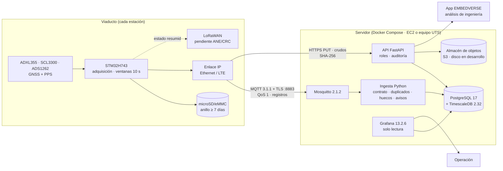
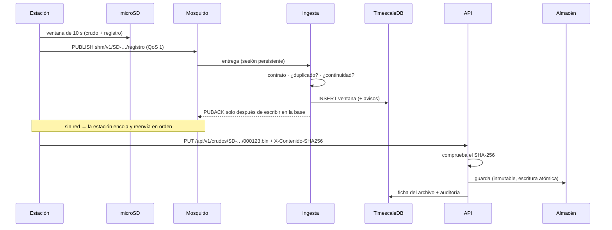

# Plataforma de datos SHM — Viaducto de La Novena

**Decisión de arquitectura para la siguiente versión del prototipo** · 12 de noviembre de 2026

> **Estado del documento.** Propuesta redactada con asistencia de IA a partir de los archivos del
> proyecto. Necesita la revisión del área de ingenierías antes de aplicarse a la instalación real.
> Cada dato lleva su fuente o su estado: **[verificado]** = comprobado en la fuente indicada en
> esta fecha; **[propuesto]** = decisión de diseño; **[pendiente]** = falta información o prueba.
> Ningún precio, versión o capacidad sale de memoria: lo que no se pudo comprobar se dice.

---

## 0. Resumen de la decisión

Se recomienda el **escenario 2, una arquitectura híbrida**. Conserva el patrón del prototipo (estación → MQTT → procesamiento → base de series temporales → tablero, sobre Docker en AWS EC2) y cambia cinco piezas donde hay una razón demostrable:

| Capa | Prototipo actual | Siguiente versión | Razón principal |
|---|---|---|---|
| Broker | EMQX (sin TLS, usuario compartido) | **Eclipse Mosquitto 2.1.2** con TLS y un usuario por estación | La carga es de ~1 mensaje/s; licencia abierta sin condiciones; configuración en archivos versionables (§9.A) |
| Procesamiento | Node-RED (lógica crítica en flujos) | **Servicios Python 3.12** (ingesta + API FastAPI) con pruebas | La lógica que decide qué es un hueco, un duplicado o un aviso tiene que poder probarse y versionarse (§9.B) |
| Series temporales | InfluxDB 2.9.1 + Flux | **PostgreSQL 17 + TimescaleDB 2.32** | Flux está en mantenimiento y InfluxDB 3 ya no lo admite, así que hay que migrar de todos modos; además el SHM necesita datos relacionales: estaciones, sensores, calibraciones, avisos y auditoría (§9.C) |
| Señal cruda | No existe | **Archivos inmutables en S3** (en un disco local para el desarrollo), con su ficha en la base | Guardar cada muestra como una fila no tiene sentido (§6, §9.C) |
| Tablero | Tablero clásico de Node-RED + exportación de ThingsBoard | **Grafana 13.2.6** para la operación y **la app EMBEDVERSE (React)** para el análisis de ingeniería | Cada herramienta en lo que hace bien (§9.D) |

Lo que **no** se introduce: Kafka, Flink, Kubernetes ni AWS IoT Core. No hacen falta con este volumen, que se calcula en el §6.

Lo que ya está hecho en el repositorio: el código de esta arquitectura en `plataforma/`, que se arranca igual en Windows y en macOS (§13), y 25 pruebas automáticas. Una de ellas hace pasar los registros del firmware real de la estación por la ingesta. **Lo que falta probar:** el arranque con Docker, porque este Mac no tiene Docker instalado (§14).

---

## 1. Diagnóstico de la infraestructura actual

**Fuentes:** `INFORME_ANALISIS_DATOS_REAL_2026-10-28.md` (inspección de solo lectura de EC2 del 28/10/2026), `nodered.json`, `flujo_monitoreo_puente.json`, `monitoreo (2).json`, `ESP32_A.ino`, `ESP32_B.ino` y `Capitulo_4_Desarrollo_Trabajo_Grado.md`.

**El servidor no se pudo inspeccionar hoy.** El 12/11/2026 la IP de los flujos y del firmware no respondía en los puertos 22, 1883, 1880, 8086, 18083 ni 3000. Hay dos causas posibles: la instancia está apagada (el informe del 28/10 anunciaba un «apagado previsto») o AWS le asignó otra IP pública al reiniciarla. Por eso este diagnóstico se basa en los archivos y en el informe, sin una inspección nueva. No se modificó nada.

### Qué funciona [verificado en el informe del 28/10]
- La cadena ESP32 → EMQX (1883) → Node-RED 5.0.8 → InfluxDB 2.9.1 recibió datos de los dos puntos (A y B) hasta el final de la inspección.
- Los contenedores `emqx`, `mynodered` e `influxdb2` corrían en Docker, sobre Amazon Linux 2023.
- Node-RED etiqueta cada punto con `sensor` y `punta`, detecta episodios y alimenta un tablero.

### Qué está limitado o mal

| # | Hallazgo | Fuente | Consecuencia |
|---|---|---|---|
| D1 | MQTT en el puerto 1883 **sin TLS**, sobre una IP pública | flujos (`usetls: false`), firmware | Credenciales y datos viajan en claro por Internet |
| D2 | Credenciales **en texto plano** en el firmware. Los dos ESP32 entran al broker con el mismo usuario administrador, y la contraseña MQTT es la misma que la del Wi‑Fi | `ESP32_*.ino` (no se reproducen aquí) | Si alguien saca un ESP32 del puente, obtiene el control del broker. **Hay que cambiar esas contraseñas ya** |
| D3 | El puerto 1880 de Node-RED quedó expuesto | informe §8 | Cualquiera podría modificar los flujos |
| D4 | La telemetría usa **QoS 0** | informe §3 | Las pérdidas no se detectan ni se recuperan |
| D5 | La IP pública está **escrita a mano** en el firmware y en los flujos | flujos, firmware | Si AWS cambia la IP al reiniciar, las estaciones quedan huérfanas. Es coherente con que hoy no responda |
| D6 | Los datos no llevan **hora de muestreo**: InfluxDB pone la hora de llegada | flujos | No se pueden alinear las estaciones entre sí; una cola de mensajes deforma la serie |
| D7 | El MPU6050 se muestrea cada 100 ms en el `loop()`, sin filtro antialias, y solo se publica el pico de 10 muestras | firmware | No sirve para análisis modal; los picos pueden ser aliasing |
| D8 | `estado=NORMAL` aparece junto a magnitudes > 2,5 m/s² (B: máx. 18,3) | informe §6 | La clasificación del firmware y el contrato no son coherentes |
| D9 | El firmware dice ser «ESP32_A» pero publica con el identificador y los tópicos de B | `ESP32_A.ino` | Los datos de A podrían haberse guardado como B |
| D10 | El esquema mezcla los campos v1 y v2; un flujo conserva `org: su_organizacion` | informe §4, flujos | El historial no es homogéneo |
| D11 | El bucket tiene retención infinita y no hay copias de seguridad documentadas | informe §2 | Si se pierde el disco, se pierde todo |
| D12 | La lógica crítica (el detector de episodios) vive en un nodo `function` de Node-RED | flujos | Es difícil de probar, revisar y versionar |
| D13 | **Grafana no aparece** en el material. Hay un tablero de Node-RED y una exportación de **ThingsBoard** con otro contrato (`deltaTotal`, `ledVerde`, `amplitudWE`…) | `monitoreo (2).json` | Conviven tres tableros con contratos distintos |
| D14 | Flux, el lenguaje de consulta de los paneles, está **en mantenimiento** y InfluxDB 3 no lo admite [verificado: docs.influxdata.com, «The future of Flux»] | — | Migrar a InfluxDB 3 obliga a reescribir todas las consultas |

**Conclusión del diagnóstico.** El prototipo demostró la cadena de datos, pero no tiene identidad por estación, cifrado, entrega garantizada, hora de muestreo, copias de seguridad ni señal cruda. Estas carencias no se resuelven retocando la configuración: vienen del diseño. La nueva estación STM32H743 + ADXL355 cambia además la naturaleza de los datos. Ahora hay ventanas de 10 s con hora GNSS, una calidad de hora declarada y archivos crudos.

---

## 2. Requisitos que rigen la decisión

Estos requisitos salen del diseño técnico de ingenierías y del firmware que ya existe:

1. **Funcionar sin Internet.** La estación guarda localmente un anillo de al menos 7 días (diseño §10). El servidor no puede ser necesario para adquirir datos.
2. **Hora de muestreo ≠ hora de recepción.** Se guardan las dos y nunca se sobrescribe la primera (contrato §8).
3. **Distinguir tres clases de problema:** falla de comunicación, falla de medición o sensor, y posible evento.
4. **No diagnosticar.** Ninguna regla automática declara daño. Los niveles E3/E4 los asigna una persona.
5. **Telemetría ≠ señal cruda.** MQTT lleva resúmenes de unos cientos de bytes; los crudos viajan como archivos.
6. **Mantenible por el equipo de la UTS.** Pocas piezas, documentadas y estándar, que se arrancan igual en Windows y en macOS.

---

## 3. Arquitectura recomendada — componentes

| Servicio | Responsabilidad | No hace |
|---|---|---|
| **Firmware de la estación** | Muestrear con un temporizador, armar ventanas de 10 s, hora GNSS/PPS, estados de calidad, CRC, guardar en la tarjeta y publicar el resumen | Diagnosticar; depender del servidor |
| **Mosquitto** | Recibir, autenticar a cada estación, autorizar por tópico, guardar los QoS 1 mientras la ingesta no está | Lógica de negocio |
| **Ingesta** (`servicio_ingesta.py`) | Aplicar el contrato, guardar las ventanas, descartar duplicados, marcar lo que llega fuera de orden, detectar huecos y solapes, clasificar los avisos y vigilar las estaciones calladas | Asignar E3/E4 |
| **API** (`api.py`) | Consultas, subida y descarga de crudos con verificación de integridad, gestión de avisos, roles y auditoría | Procesar señal (eso queda para una fase posterior) |
| **TimescaleDB** | Ventanas (una fila cada 10 s), inventario, avisos, fichas de crudos, rechazos, credenciales y auditoría | Guardar muestras individuales |
| **Almacén de objetos** | Bytes de los crudos, inmutables | — |
| **Grafana** | Operación: disponibilidad, calidad de la hora, avisos y últimas ventanas | Gestionar avisos (lo hace la API) |
| **App EMBEDVERSE** | Vistas de ingeniería: estación, circuito, firmware y, más adelante, espectros | — |

---

## 4. Flujo de datos

---

## 5. Comunicaciones

| Tramo | Protocolo | Contenido | Estado |
|---|---|---|---|
| Sensor → MCU | SPI (ADXL355, SCL3300, ADS1262), UART (GNSS), EXTI (PPS) | Muestras | Firmware en esqueleto [verificado: Renode] |
| Estación → servidor (telemetría) | MQTT 3.1.1, QoS 1, TLS 1.2+ en 8883 | Registro JSON de ~700 B cada 10 s | [propuesto]; el protocolo de la pasarela está **pendiente** con ingenierías |
| Estación → servidor (crudos) | HTTPS `PUT` con token de estación | Archivo binario por ventana o por bloque | [propuesto]; el formato del archivo en la SD está **pendiente** |
| Estación → servidor (LoRaWAN) | LoRaWAN → servidor de red → MQTT | Solo estado y alarmas | **[pendiente]**: la banda y la potencia dependen de ANE/CRC (diseño §8). Haría falta un servidor de red LoRaWAN, que no se incluye hasta confirmarlo |
| Servidor → operadores | HTTPS (API, Grafana) detrás de un proxy inverso | — | [propuesto] |

**Tópicos MQTT** (versionados):

| Tópico | Dirección | QoS | Retenido |
|---|---|---|---|
| `shm/v1/{station_id}/registro` | estación → servidor | 1 | no |
| `shm/v1/{station_id}/estado` | estación → servidor (también su LWT) | 1 | **sí** |
| `shm/v1/{station_id}/evento` | estación → servidor | 1 | no; reservado, sin contrato aún |
| `shm/v1/{station_id}/config` | servidor → estación | 1 | sí; reservado |

El broker solo deja a cada estación escribir en su propia rama (`mosquitto/acl`, `pattern write shm/v1/%u/…`). Además, la ingesta comprueba que el `station_id` del cuerpo coincida con el del tópico.

---

## 6. Volumen de datos

Calculado con `python -m shm_plataforma.volumen`. Los supuestos están escritos en el código. La fila de 200 Hz en float32 reproduce el ejemplo del diseño técnico §10 (414,7 MB/día con margen ×2), y una prueba lo comprueba.

**Supuestos:** 3 ejes, adquisición continua y una cabecera de 256 B por bloque de 10 s. En «int24» cada eje ocupa 3 bytes (los 20 bits del ADXL355). La microSD lleva un margen ×2 (diseño §10).

**Crudo por estación (int24):**

| Muestreo | B/s | MB/h | GB/día | GB/mes | kbit/s para subirlo todo | microSD 7 días ×2 |
|---:|---:|---:|---:|---:|---:|---:|
| 100 Hz | 926 | 3,3 | 0,08 | 2,4 | 7,4 | 1,1 GB |
| 200 Hz | 1 826 | 6,6 | 0,16 | 4,7 | 14,6 | 2,2 GB |
| 500 Hz | 4 526 | 16,3 | 0,39 | 11,7 | 36,2 | 5,5 GB |
| 1000 Hz | 9 026 | 32,5 | 0,78 | 23,4 | 72,2 | 10,9 GB |

En float32, que es lo que guarda hoy el firmware, el volumen sube un 33 %: a 200 Hz son 6,3 GB/mes y 2,9 GB en la tarjeta para 7 días.

**Crudo de la red (int24, GB/mes):**

| Muestreo | 4 estaciones | 10 estaciones | 20 estaciones |
|---:|---:|---:|---:|
| 100 Hz | 10 | 24 | 48 |
| 200 Hz | 19 | 47 | 95 |
| 500 Hz | 47 | 117 | 235 |
| 1000 Hz | 94 | 234 | 468 |

**Telemetría por MQTT:** unos 236 MB/mes por estación (700 B cada 10 s más un 30 % de sobrecarga), **sea cual sea el muestreo**. MQTT nunca lleva muestras.

**Lo que significan estas cifras para la decisión:**
- **Mensajes:** 20 estaciones × 0,1 mensajes/s = 2 mensajes/s. Cualquier broker lo maneja; **Kafka no se justifica**.
- **Base de datos:** una fila de ~1 KB cada 10 s por estación da ~0,26 GB/mes por estación. Una sola instancia de PostgreSQL basta durante años.
- **Crudos:** son el único volumen grande, y crece sin límite. Van a un almacén de objetos con ciclo de vida, no a la base.
- **Enlace:** subir todo el crudo a 200 Hz pide ~15 kbit/s sostenidos, algo viable por Ethernet o LTE. **Por LoRaWAN no se puede.**
- **Muestreo:** el diseño parte de 200 Hz (banda de 0,1–40 Hz). Las frecuencias que el ADXL355 admite de forma nativa están **[pendientes]**: el mapa de registros del firmware aún no se ha cotejado con la hoja de datos, así que no se puede afirmar si 100/200 Hz exigen diezmar desde 250/500 Hz.

---

## 7. Comportamiento ante fallas

| Situación | Qué pasa | Dónde está implementado |
|---|---|---|
| **Se cae Internet** | La estación sigue adquiriendo y guarda en la microSD. La pasarela encola en disco y reenvía **en orden** al volver la red | Firmware (anillo: **[pendiente]**, falta el driver SD); `pasarela_sim.py` (cola persistente) [verificado con pruebas] |
| **Una estación deja de hablar** | Tras 6 periodos sin mensajes (60 s) se abre el aviso `ESTACION_SILENCIOSA`, de categoría **comunicación** y no del puente. Se cierra solo cuando la estación vuelve | `estaciones_silenciosas`, `marcar_visto` |
| **Se reinicia el servidor** | Mosquitto guarda los QoS 1 en disco. La ingesta usa una sesión persistente y **solo confirma después de escribir en la base**: si se cae a mitad, el broker vuelve a entregar | `servicio_ingesta.py` (`manual_ack`); `mosquitto.conf` (`persistence true`) |
| **Se llena la tarjeta local** | Anillo circular: se sobrescribe lo más antiguo **ya confirmado**, y la estación declara `STORAGE_FAULT` si no puede escribir | **[pendiente]**: el driver SD aún no existe; hoy el firmware siempre declara `STORAGE_FAULT` |
| **Mensajes duplicados** | Clave `(station_id, timestamp_utc)`. Con el mismo CRC se descarta en silencio. Con otro CRC es un **conflicto**: se conserva el primero y se avisa | `Ingestor.procesar` [verificado con pruebas] |
| **Datos fuera de orden** | Se guardan y quedan marcados con `fuera_de_orden`. No disparan avisos de continuidad | ídem |
| **Discontinuidad temporal** | `HUECO_TEMPORAL` o `SOLAPE_TEMPORAL` entre ventanas consecutivas. Si cambió la calidad de la hora, el aviso dice que puede ser un salto del reloj | `_continuidad` |
| **Sensor saturado o en falla** | Estados `SATURATED`, `SENSOR_FAULT` o `DATA_GAP` → aviso de **medición** E1: «no es una anomalía estructural». Los huecos nunca se rellenan con cero | `clasificar`; firmware (`DATA_RDY`, DEVID cada 1 s) |
| **Mensaje inválido** | No se pierde: va a la tabla `rechazos` con el mensaje original y el motivo | `_rechazar` |
| **Captura de evento** | Aviso E2 «requiere revisión técnica». **Solo una persona con rol ingeniero puede subirlo a E3/E4**, por la API y con una justificación escrita que queda en la auditoría | `clasificar`; `POST /avisos/{id}/nivel` |

---

## 8. Modelo de almacenamiento

Esquema completo en `db/001_esquema.sql`.

| Tabla | Una fila es… | Clave | Crece |
|---|---|---|---|
| `estaciones`, `sensores`, `calibraciones` | Inventario y trazabilidad | id | Casi nada |
| `ventanas` (hypertable, particiones de 7 días) | Una ventana de 10 s: hora de muestreo **y** de recepción, calidad de hora, estados, CRC, contadores y el mensaje JSON completo | `(station_id, inicio)` | ~8 640 filas/día/estación |
| `estado_estacion` | Último estado retenido y último mensaje | station_id | Fijo |
| `archivos_crudos` | **Ficha** del archivo: clave en el almacén, bytes, SHA-256 y ventana | `(station_id, nombre)` | Una fila por archivo |
| `avisos` | Comunicación, medición, continuidad, posible evento o integridad; nivel E0–E4; reconocimiento | id | Bajo |
| `rechazos` | Mensaje inválido y sus motivos | id | Bajo |
| `credenciales` | SHA-256 del token, rol y estación | id | Fijo |
| `auditoria` | Quién hizo qué y cuándo | id | Bajo |

**Crudos:** las claves tienen la forma `crudos/{station_id}/{nombre}`. Son inmutables: subir el mismo contenido otra vez no hace nada, y subir otro contenido con el mismo nombre devuelve 409. En S3 se escriben con `ChecksumSHA256` y escritura condicional. La backend de S3 está **[pendiente de prueba]**; la de disco está probada.

**Retención [propuesto, a decidir con ingenierías]:** las ventanas se conservan indefinidamente porque pesan poco. Los crudos pasan a S3 Standard y, tras 90 días, a una clase de archivo. Los rechazos se guardan un año. Cuando el volumen lo pida, se activa la compresión columnar de TimescaleDB. No se activa en el arranque porque su API cambió en la 2.18 y **no está probada** en esta versión.

---

## 9. Comparación de tecnologías

Puntuación del 1 (malo) al 5 (muy bueno) para **este** proyecto (4 a 20 estaciones, un equipo universitario). Son juicios de ingeniería argumentados, no resultados de benchmarks: no se citan cifras de rendimiento que no se hayan medido.

### A. Broker

| | Adecuación | Seguridad (TLS/mTLS/ACL) | Operación | Licencia | Recursos | Dependencia | **Total** |
|---|---|---|---|---|---|---|---|
| **Mosquitto 2.1** | 5 | 4 | 5 | 5 (EPL-2.0/EDL-1.0) | 5 | 5 | **29** |
| EMQX 6.x | 4 | 5 | 4 | 3 (BSL 1.1 desde la 5.9) | 3 | 3 | 22 |
| HiveMQ CE | 3 | 3 | 3 | 4 | 3 | 3 | 19 |
| Kafka | 1 | 4 | 2 | 5 | 1 | 4 | 17 |

- **EMQX** sigue siendo una opción válida (escenario 1). Desde la versión 5.9 se distribuye con Business Source License 1.1. Un solo nodo es gratuito, el clúster exige licencia, y las instituciones académicas pueden usarlo sin límite de nodos para fines no comerciales [verificado: emqx.com/en/content/license-faq]. Se prefiere Mosquitto por tres razones. Primero, si la operación pasa al dueño del puente o a un contratista, el uso deja de ser académico. Segundo, el volumen (≤ 2 mensajes/s) no necesita clúster, motor de reglas ni panel. Tercero, la configuración de Mosquitto son dos archivos de texto que se versionan y se revisan.
- **Kafka** no se justifica: está pensado para millones de eventos con muchos consumidores, y aquí hay 2 mensajes/s y un solo consumidor.
- MQTT es un estándar, así que **cambiar de broker no toca a las estaciones**.

### B. Procesamiento

| | Probabilidad de errores | Pruebas | Ecosistema de señal | Curva para el equipo | **Decisión** |
|---|---|---|---|---|---|
| **Python 3.12 (servicios + FastAPI)** | Baja | Unitarias, ya escritas | numpy/scipy para PSD/OMA | Conocido (los generadores del proyecto ya son Python) | **Seleccionado** |
| Node-RED | Media (lógica en nodos `function`) | Difícil | Pobre | Muy baja | Fuera del camino crítico; se puede conservar para automatizaciones no críticas |
| Go / Java | Baja | Buenas | Pobre / medio | Alta para el equipo | No se justifica |
| Flink / Kafka Streams | — | — | — | Alta | Sin volumen que lo pida |

### C. Base de datos

| | Series temporales | Datos relacionales (inventario, avisos, auditoría) | Lenguaje | Licencia | **Decisión** |
|---|---|---|---|---|---|
| **PostgreSQL + TimescaleDB (Community)** | 5 | 5 | SQL | TSL: gratuita en infraestructura propia; no se puede revender como servicio [verificado: docs.timescale.com, ediciones] | **Seleccionado** |
| InfluxDB 2.x | 4 | 1 | Flux (en mantenimiento) | MIT | Solo lectura para el histórico del prototipo |
| InfluxDB 3 Core | 4 | 1 | SQL/InfluxQL; sin Flux | MIT/Apache | Obligaría a migrar igual y seguiría sin modelo relacional |
| QuestDB / VictoriaMetrics / ClickHouse | 5 | 2 | variado | variado | Exceso de capacidad; una pieza más que operar |

**Crudos:** almacén de objetos. **MinIO no se usa:** su edición comunitaria dejó de publicar binarios e imágenes en octubre de 2025 y el repositorio se archivó [verificado en varias fuentes; ver referencias]. En desarrollo se usa una carpeta, y en producción S3.

### D. Visualización

| | Operación en tiempo real | Espectros / análisis | Usuarios y permisos | Esfuerzo | **Decisión** |
|---|---|---|---|---|---|
| **Grafana OSS** | 5 | 2 | 4 | Bajo | **Operación** |
| **App propia (React, EMBEDVERSE)** | 3 | 5 | La API lo resuelve | Medio, pero ya existe | **Ingeniería** |
| Tablero de Node-RED | 2 | 1 | 1 | Bajo | Se retira |
| ThingsBoard | 3 | 2 | 4 | Medio | No se adopta: otra plataforma completa |

### E. Infraestructura

| | Decisión | Razón |
|---|---|---|
| **Docker Compose** | Seleccionado | Mismo archivo en Windows, macOS y Linux; el equipo ya usa Docker |
| **EC2, una instancia** | Seleccionado para el piloto | El equipo ya lo conoce; el volumen lo permite |
| **S3** | Seleccionado para los crudos | Durabilidad y ciclo de vida, sin servidores que operar |
| RDS | Opcional más adelante | Quita las copias de seguridad de las manos del equipo, pero cuesta más. Hay que comprobar el soporte de TimescaleDB antes de elegirlo **[pendiente]** |
| AWS IoT Core | No | Ata la identidad de las estaciones a AWS y no aporta nada con 20 estaciones |
| Kubernetes | No | Una instancia con Compose basta; K8s añade operación sin beneficio a esta escala |

---

## 10. Seguridad

| Medida | Cómo | Estado |
|---|---|---|
| Cifrado | TLS 1.2+ en MQTT (8883) y en HTTPS (proxy inverso con certificado) | Plantilla en `mosquitto.conf` [propuesto] |
| Identidad por estación | Un usuario MQTT por estación (`station_id`) y un token de API de rol `estacion`. Siguiente paso: **mTLS** con un certificado por estación (`require_certificate`, `use_identity_as_username`) | Usuarios por estación [hecho]; mTLS [propuesto] |
| Autorización por tópico | ACL: cada estación escribe solo en `shm/v1/{su id}/…` | [hecho] |
| Anti-suplantación | La ingesta rechaza un registro cuyo `station_id` no coincida con el del tópico | [hecho, probado] |
| Segmentación | Solo se exponen 8883 y 443. La base, Grafana y la API quedan detrás del proxy; SSH solo desde la IP de la UTS | En desarrollo todo se publica en `127.0.0.1` [hecho] |
| API | Token Bearer por persona y rol (lectura, operador, ingeniero, estacion). Solo se guarda el SHA-256 | [hecho, probado] |
| Auditoría | Toda escritura (reconocer un aviso, cambiar un nivel, subir un crudo, crear o revocar una credencial) queda en `auditoria` | [hecho] |
| Integridad | CRC-32 por ventana (firmware) y SHA-256 por archivo (API y S3) | [hecho] |
| Secretos | `.env` y `secretos/` se generan en cada equipo con valores aleatorios y nunca entran al repositorio. En producción, AWS Secrets Manager o SSM Parameter Store | [hecho] / [propuesto] |
| Firmware | Imágenes firmadas; actualización A/B aprovechando los dos bancos de flash del STM32H743; vuelta atrás si el watchdog no se refresca tras arrancar | **[pendiente]**: diseño con ingenierías |
| Credenciales del prototipo | **Cambiar ya** la contraseña del usuario administrador de EMQX y la del Wi‑Fi (D2), y cerrar el 1880 (D3) | **Acción inmediata** |

---

## 11. Operación y recuperación

- **Copias de seguridad:** `pg_dump` diario comprimido, subido a S3 con versionado, y una prueba de restauración cada mes. Los crudos ya están en S3.
- **Monitoreo de la infraestructura:** el aviso `ESTACION_SILENCIOSA` cubre las estaciones. Para el servidor: el endpoint `/api/v1/salud`, una alarma de CloudWatch por CPU, disco y estado de la instancia, y `restart: unless-stopped` en todos los servicios.
- **IP fija:** una **Elastic IP** o un nombre DNS. Las estaciones nunca deben tener una IP escrita a mano (D5).
- **Actualizaciones:** las imágenes están fijadas a una versión exacta (`2.32.0-pg17`, `2.1.2-alpine`, `13.2.6`), así que una actualización es un cambio revisado en `docker-compose.yml`, nunca un `latest`.
- **Recuperación desde cero:** instancia nueva → `git clone` → restaurar `.env` desde el gestor de secretos → `docker compose up -d` → restaurar el último `pg_dump`. Los objetivos de RPO y RTO son **[pendientes]**: los fija el dueño del activo.

---

## 12. Recursos y costos

Instancia para el piloto (4 a 10 estaciones): **t3.medium** (2 vCPU, 4 GiB). El uso de memoria de los cinco contenedores es **una estimación sin medir**; hay que confirmarlo con `docker stats` en el primer arranque.

| Concepto | Precio de referencia | Mes | Fuente y estado |
|---|---|---|---|
| EC2 t3.medium, us-east-2, bajo demanda | US$ 0,0416/h | ≈ US$ 30,4 | Rastreadores de precios de terceros (DoiT, Holori); **confirmar en aws.amazon.com/ec2/pricing** |
| IPv4 pública (Elastic IP) | US$ 0,005/h | ≈ US$ 3,65 | Anuncio de AWS de 2023, recogido por varias fuentes |
| S3 Standard | US$ 0,023/GB-mes (los primeros 50 TB) | 4 est. a 200 Hz: ~US$ 0,44 el primer mes; ~US$ 5,2/mes al cabo de un año (228 GB) | Tarifa de N. Virginia; **la de Ohio está sin confirmar** |
| Transferencia de entrada | Gratis | 0 | Varias fuentes |
| Transferencia de salida a Internet | ~US$ 0,09/GB tras 100 GB/mes | ≈ 0 en el piloto | Terceros; **confirmar** |
| Disco EBS (gp3) | — | — | **[pendiente]**: precio sin verificar en esta revisión |
| Datos LTE en Colombia | — | — | **[pendiente]**: cotizar con operadores; ~6 GB/mes por estación si se suben todos los crudos a 200 Hz en int24 |

**Orden de magnitud del piloto:** unos US$ 35–45/mes de AWS, más el disco EBS y las copias de seguridad, sin contar el LTE. Con t3.large (US$ 0,0832/h, ≈ US$ 61/mes) si `docker stats` muestra que hace falta.

---

## 13. Habilitado en Windows y macOS

Todo se ejecuta en contenedores Linux, así que el mismo `docker-compose.yml` sirve en los dos sistemas. Lo único que depende del equipo es el arranque:

| | Windows | macOS |
|---|---|---|
| Requisito | Docker Desktop con WSL 2 | Docker Desktop (Intel o Apple silicon) |
| Python (solo para `preparar.py`) | 3.9 o posterior (`py`) | 3.9 o posterior |
| Arrancar | `powershell -ExecutionPolicy Bypass -File scripts\iniciar.ps1 demo` | `sh scripts/iniciar.sh demo` |

Medidas para que funcione igual en ambos:
- `.gitattributes` fuerza LF en los archivos que leen los contenedores.
- El broker recibe su configuración en un volumen preparado por `broker-init`, así que los permisos de archivo de Windows no le afectan.
- La pasarela simulada compila el firmware **dentro** del contenedor, así que Windows no necesita compilador de C.

Instrucciones paso a paso en `plataforma/README.md`.

---

## 14. Plan de migración desde el prototipo

| Fase | Qué | Criterio para pasar a la siguiente |
|---|---|---|
| **0 · Contención (ya)** | Cambiar las credenciales del prototipo (D2), cerrar 1880 y 8086 a Internet (D3), corregir el identificador de ESP32_A (D9) y asignar una Elastic IP (D5) | Inspección de puertos limpia |
| **1 · Plataforma en local** | `iniciar demo` en un equipo con Docker; comprobar los registros en Grafana y en la API; `docker stats` | Ingesta sin rechazos; las pruebas de §7 reproducidas con el broker real |
| **2 · Exportar el histórico** | Exportar `puente_datos_reales` de InfluxDB a CSV (solo lectura) y guardarlo como archivo del prototipo, **sin mezclarlo** con las ventanas nuevas, porque los contratos son distintos | Recuento de puntos igual antes y después |
| **3 · Servidor nuevo** | EC2 + Elastic IP + TLS + copias en S3, en paralelo al viejo. El prototipo ESP32 sigue en su EMQX | Una semana sin pérdidas con la estación simulada |
| **4 · Primera estación STM32** | Con la placa Nucleo + ADXL355 en el laboratorio: drivers de la SD y de Ethernet, pasarela real y crudos por la API | Registros válidos y crudos con SHA-256 correcto |
| **5 · Retiro** | Apagar EMQX, Node-RED e InfluxDB una vez archivado el histórico | Aprobación de ingenierías |

**Pendientes que bloquean fases** (están en la solicitud a ingenierías): el protocolo de la pasarela, el formato del archivo en la SD, el rango, la ODR y el filtro del ADXL355, la calidad de hora INVALID, la cobertura LTE o la viabilidad de LoRaWAN, y el RPO/RTO.

---

## 15. Tecnologías seleccionadas

| Tecnología | Versión fijada | Comprobado | Justificación | Referencia |
|---|---|---|---|---|
| Eclipse Mosquitto | `eclipse-mosquitto:2.1.2-alpine` | Docker Hub, 12/11/2026 | §9.A | mosquitto.org |
| PostgreSQL + TimescaleDB Community | `timescale/timescaledb:2.32.0-pg17` (sin `-oss`, para tener las funciones de la TSL) | Docker Hub, 12/11/2026 | §9.C | docs.timescale.com |
| Grafana OSS | `grafana/grafana:13.2.6` | Docker Hub, 12/11/2026 | §9.D | grafana.com/docs |
| Python | `python:3.12.16-slim-trixie` | Docker Hub, 12/11/2026 | §9.B | python.org |
| FastAPI | 0.162.5 | PyPI, 12/11/2026 | API tipada, OpenAPI automática | fastapi.tiangolo.com |
| Uvicorn | 0.54.0 | PyPI | Servidor ASGI | uvicorn.dev |
| paho-mqtt | 2.2.0 | PyPI | Cliente MQTT de Eclipse | eclipse.dev/paho |
| psycopg | 3.3.9 | PyPI | Controlador PostgreSQL | psycopg.org |
| boto3 | 1.44.1 | PyPI | S3 (opcional) | aws.amazon.com/sdk-for-python |
| Docker Desktop | la vigente | — | Windows (WSL 2) y macOS | docs.docker.com/desktop |

Las versiones probadas **localmente** fueron FastAPI 0.162.5 y pydantic 2.14.3 sobre Python 3.15.2, y el núcleo sobre Python 3.9.6. Las versiones de las imágenes están comprobadas, pero **la pila completa aún no se ha arrancado** (falta Docker en este equipo).

### Referencias consultadas el 12/11/2026
- EMQX, licencia y FAQ: https://www.emqx.com/en/content/license-faq · https://www.emqx.com/en/blog/adopting-business-source-license-to-accelerate-mqtt-and-ai-innovation
- Mosquitto 2.1: https://mosquitto.org/blog/2026/01/rc-2.1.0rc1-available/ · Docker Hub `eclipse-mosquitto`
- TimescaleDB, ediciones y licencia: https://docs.timescale.com/about/latest/timescaledb-editions
- InfluxDB 3 Core y el futuro de Flux: https://docs.influxdata.com/influxdb3/core/release-notes/ · https://docs.influxdata.com/flux/v0/future-of-flux/
- MinIO, fin de los binarios comunitarios: https://itsfoss.com/news/minio-moves-away-from-open-source/ · https://dev.to/rosgluk/minio-ce-in-2026-retired-upstream-source-only-and-what-to-use-1k02
- Precios de S3: https://www.cloudforecast.io/blog/amazon-s3-pricing-and-optimization-guide/ · EC2 us-east-2: https://www.doit.com/compute/spot/us-east-2/t3.medium · IPv4: https://www.instaclustr.com/blog/aws-public-ipv4-address-charge-and-instaclustr-customer-impact/
- Docker Desktop: https://docs.docker.com/desktop/setup/install/
